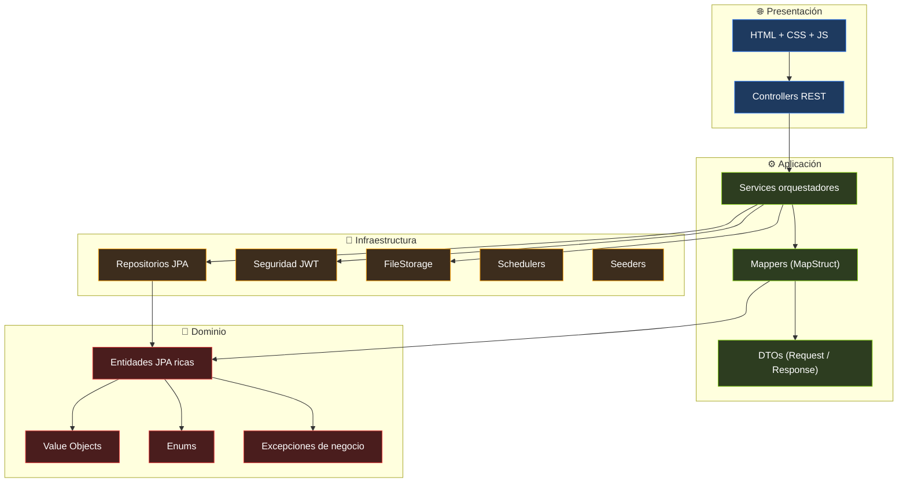
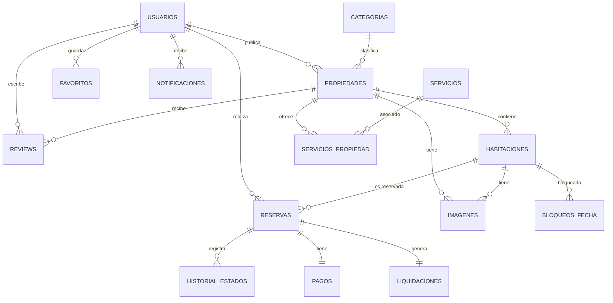

# 🏡 MundoTerraza — Plataforma de Reservas de Alojamientos

[](https://openjdk.org/)
[](https://spring.io/projects/spring-boot)
[](https://www.mysql.com/)
[](https://maven.apache.org/)
[](https://podman.io/)
[](https://www.docker.com/products/docker-desktop/)
[](https://www.gnu.org/licenses/gpl-3.0)
[](https://developer.mozilla.org/docs/Web/JavaScript)
[](https://jwt.io/)

Aplicación web para reservar alojamientos entre huéspedes y anfitriones. Backend en **Spring Boot 3.3.5** con **arquitectura hexagonal pragmática** y **DDD aplicado**; frontend vanilla JavaScript con **ES Modules** y CSS modular con **BEM + tokens**. Persistencia en **MySQL 8** versionada con **Flyway**. Autenticación **stateless** con **JWT** (access + refresh) y contraseñas hasheadas con **BCrypt**.

> ℹ️ **Estado del repositorio:** activo · **Versión:** `v1.1` · **Licencia:** GPLv3

---

## ✨ Características Principales

- **Arquitectura hexagonal pragmática** — dependencias apuntan siempre hacia el dominio.
- **DDD aplicado** — entidades ricas, Value Objects y agregados con invariantes.
- **Autenticación JWT stateless** — access 15 min + refresh 7 días. Sin rotación real en v1 (ver ADR-003).
- **Contraseñas con BCrypt** — hash + salt automático, sin texto plano en BD.
- **Bloqueo tras 5 intentos fallidos** — protección contra fuerza bruta.
- **Validación en tres capas** — Bean Validation en DTOs, invariantes en entidades, lógica en servicios.
- **Manejo global de errores** — un `GlobalExceptionHandler` centralizado devuelve `ErrorResponse` uniforme.
- **Comisión del 15%** — cálculo automático al crear cada reserva, con liquidación al anfitrión.
- **Instant booking con pasarela simulada** — el huésped paga y la reserva se confirma automáticamente. Rechazo simulable con `referencia = "FAIL-*"`.
- **Migraciones Flyway** — esquema versionado, sin `ddl-auto=update` en producción.
- **Logs correlacionados por `requestId`** — MDC + `OncePerRequestFilter` + aspecto `@Around`.
- **Frontend sin frameworks** — ES Modules nativos, CSS con tokens y BEM, cero CDN.
- **OpenAPI / Swagger** — documentación viva en `/swagger-ui.html`.
- **147 tests** — value objects, entidades y servicios (JUnit 5 + Mockito).

---

## 📋 Requisitos

| Componente | Versión mínima | Notas |
|------------|----------------|-------|
| **Java JDK** | 21 | Recomendado: [Adoptium Temurin](https://adoptium.net/) |
| **Maven** | 3.9+ | O usar el wrapper `./mvnw` si está incluido |
| **Docker Desktop** | Cualquiera reciente | Windows / macOS |
| **Podman** | 4.9+ | Alternativa en Linux (rootless) |

> **Windows:** instalar [Docker Desktop](https://www.docker.com/products/docker-desktop/) y Java 21. No se requiere MySQL nativo.
> **Linux:** usar Podman en modo rootless (sin daemon).

### 🖥️ Hardware de referencia

| Recurso | Mínimo | Recomendado |
|---------|--------|-------------|
| **CPU** | 2 cores x86_64 | 4 cores @ 2.0 GHz+ |
| **RAM libre** | 2 GB | 4 GB |
| **Disco libre** | 3 GB | 5 GB |
| **Kernel (Linux)** | 5.15+ | 6.8+ |

**Espacio en disco (aproximado):**

| Componente | Tamaño |
|------------|--------|
| Imagen MySQL 8.0 | ~600 MB |
| Proyecto + dependencias Maven | ~200 MB |
| Volumen de la BD (con datos) | ~50 MB |
| **Total estimado** | **~1 GB** |

---

## 🚀 Quick Start

### 1. Clonar el repositorio

```bash
git clone <url-del-repo>
cd MundoTerrazaAPP
```

### 2. Levantar la base de datos

**Docker (Windows / macOS):**

```bash
docker compose up -d
```

**Podman (Linux):**

```bash
podman run -d --name mysql-terraza \
  -e MYSQL_ROOT_PASSWORD=root123 \
  -e MYSQL_DATABASE=mundo_terraza_db \
  -e MYSQL_USER=terraza \
  -e MYSQL_PASSWORD=terraza123 \
  -p 3306:3306 \
  -v mysql-terraza-data:/var/lib/mysql \
  docker.io/library/mysql:8.0
```

### 3. Arrancar el backend

```bash
mvn spring-boot:run
```

Flyway aplica `V1__init_schema.sql` y `V2__seed_catalogo.sql` automáticamente. Los seeders cargan **7 categorías** y **15 servicios base**.

### 4. Abrir la aplicación

| Recurso | URL |
|---------|-----|
| Aplicación | http://localhost:8080 |
| Swagger UI | http://localhost:8080/swagger-ui.html |
| API Docs | http://localhost:8080/v3/api-docs |

### 5. Crear una cuenta

No hay usuarios precargados. Ingresa a [`/auth.html`](http://localhost:8080/auth.html) y regístrate. Por defecto todos los usuarios son **HUESPED**. Para publicar propiedades, presiona **Hazte Anfitrión** en el navbar.

### Ejemplo de uso

```bash
# Registrar un usuario
$ curl -X POST http://localhost:8080/api/auth/register \
    -H "Content-Type: application/json" \
    -d '{"nombre":"Test","correo":"test@test.com","password":"secreto123"}'

{
  "id": 1,
  "nombre": "Test",
  "correo": "test@test.com",
  "rol": "HUESPED",
  "esAnfitrion": false,
  "accessToken": "eyJhbGciOiJIUzM4NCJ9...",
  "refreshToken": "eyJhbGciOiJIUzM4NCJ9..."
}

# Consultar el catálogo (público)
$ curl http://localhost:8080/api/propiedades?pagina=0&tamanio=10

{
  "contenido": [...],
  "pagina": 0,
  "tamanio": 10,
  "total": 5,
  "totalPaginas": 1,
  "esUltima": true
}
```

---

## 📚 Documentación

| Documento | Contenido |
|-----------|-----------|
| [Arquitectura](docs/arquitectura.md) | Capas, dependencias, decisiones de diseño |
| [Modelo de dominio](docs/modelo-dominio.md) | Entidades, relaciones y reglas de negocio |
| [API](docs/api.md) | Endpoints REST con ejemplos |
| [Frontend](docs/frontend.md) | Estructura JS/CSS, convenciones |
| [Despliegue](docs/despliegue.md) | Variables de entorno, Docker, producción |
| [Decisiones](docs/decisiones.md) | ADRs - Architecture Decision Records |
| [Contribuir](CONTRIBUTING.md) | Guía de contribución |

---

## 🎯 Módulos del Sistema

| Módulo | Descripción | Estado |
|--------|-------------|--------|
| **Autenticación** | Registro, login, refresh, become-host | ✅ Completo |
| **Catálogo público** | Búsqueda con filtros y paginación | ✅ Completo |
| **Propiedades** | CRUD, imágenes, servicios, publicación | ✅ Completo |
| **Habitaciones** | CRUD de habitaciones | ✅ Backend completo |
| **Disponibilidad** | Consulta de unidades disponibles por rango | ✅ Backend completo |
| **Bloqueos de fecha** | Anfitrión bloquea fechas sin reserva | ✅ Backend completo |
| **Reservas** | Crear, cancelar, completar, historial de estados | ✅ Backend completo |
| **Pagos** | Instant booking con pasarela simulada (aprobación/rechazo automático) | ✅ Backend completo |
| **Liquidaciones** | Generación automática al completar reserva | ✅ Backend completo |
| **Reviews** | Crear, editar (30 días), responder, rating denormalizado | ✅ Backend completo |
| **Favoritos** | Wishlist por usuario | ✅ Backend completo |
| **Notificaciones** | In-app, disparadas por eventos del dominio | ✅ Backend completo |

> ℹ️ Los módulos marcados con "Backend completo" tienen API REST funcional pero su integración en el frontend está en curso.

---

## 🧱 Arquitectura

### 🔷 Diagrama de capas



### 📐 Regla de dependencias

```
controller  →  application  →  domain
                    ↓
              infrastructure  →  domain
```

- El **dominio** no conoce a nadie (sin Spring, sin JPA, sin HTTP).
- La **aplicación** orquesta: usa el dominio y los adaptadores de salida.
- La **infraestructura** implementa los puertos (repositorios, seguridad, storage).
- Los **controllers** son adaptadores de entrada: traducen HTTP ↔ DTOs.

### 🗺️ Mapa de paquetes

```text
app/
├── config/                Configuración Spring (Security, Web, OpenAPI, Jackson, ExceptionHandler)
├── controller/            Adaptadores HTTP (11 controllers REST)
├── application/
│   ├── dto/
│   │   ├── request/       17 DTOs de entrada con Bean Validation
│   │   └── response/      19 DTOs de salida (records)
│   ├── mapper/            13 mappers MapStruct
│   └── service/           13 servicios orquestadores
├── domain/
│   ├── model/             15 entidades JPA + ServicioPropiedadId
│   ├── valueobject/       8 VOs (Dinero, Email, Dni, Telefono, Password, Capacidad, Porcentaje, Coordenada)
│   ├── enums/             13 enums del dominio
│   ├── converter/         6 AttributeConverters JPA
│   └── exception/         7 excepciones de negocio
└── infrastructure/
    ├── repository/        15 repositorios Spring Data JPA
    ├── security/          JWT + filtros + providers
    ├── storage/           Almacenamiento de imágenes
    ├── observability/     RequestIdFilter + LoggingAspect
    ├── scheduler/         Jobs programados (purga, reconciliación)
    └── seed/              Seeders de catálogos
```

### 🗄️ Modelo de datos



---

## 📁 Estructura del Repositorio

```text
MundoTerrazaAPP/
├── docs/                              # Documentación del proyecto
│   ├── scripts/
│   │   └── smoke-test.sh              # Smoke test end-to-end
│   ├── api.md
│   ├── arquitectura.md
│   ├── decisiones.md
│   ├── despliegue.md
│   ├── frontend.md
│   └── modelo-dominio.md
├── src/
│   ├── main/
│   │   ├── java/app/                  # Código Java
│   │   │   ├── application/
│   │   │   ├── config/
│   │   │   ├── controller/
│   │   │   ├── domain/
│   │   │   └── infrastructure/
│   │   └── resources/
│   │       ├── db/migration/          # Migraciones Flyway (V1, V2)
│   │       ├── static/                # Frontend (HTML + CSS + JS)
│   │       │   ├── css/
│   │       │   │   ├── base/
│   │       │   │   ├── components/
│   │       │   │   ├── pages/
│   │       │   │   ├── utilities/
│   │       │   │   └── style.css      # Entry point (@imports)
│   │       │   ├── js/
│   │       │   │   ├── components/
│   │       │   │   ├── features/
│   │       │   │   ├── pages/
│   │       │   │   ├── services/
│   │       │   │   ├── api.js
│   │       │   │   ├── format.js
│   │       │   │   └── session.js
│   │       │   ├── index.html
│   │       │   ├── auth.html
│   │       │   └── detalle.html
│   │       ├── application.properties
│   │       └── logback-spring.xml
│   └── test/
│       └── java/app/                  # 147 tests (JUnit 5 + Mockito)
├── uploads/                           # Imágenes subidas (runtime)
│   └── .gitkeep
├── .gitignore
├── CONTRIBUTING.md
├── docker-compose.yml
├── LICENSE.md
├── pom.xml
└── README.md
```

---

## 🛠 Comandos Disponibles

| Acción | Comando |
|--------|---------|
| Levantar la BD (Docker) | `docker compose up -d` |
| Detener la BD | `docker compose down` |
| Compilar | `mvn clean compile` |
| Ejecutar la app | `mvn spring-boot:run` |
| Ejecutar con perfil dev | `mvn spring-boot:run -Dspring-boot.run.profiles=dev` |
| Empaquetar JAR | `mvn clean package -DskipTests` |
| Ejecutar JAR | `java -jar target/*.jar` |
| Ejecutar todos los tests | `mvn test` |
| Ejecutar un test específico | `mvn test -Dtest=ReservaTest` |
| Ver el árbol del proyecto | `tree -L 3 -I 'target\|uploads\|logs'` |

### 🔄 Ciclo de vida de la base de datos

| Comando | Contenedores | Volumen | Datos |
|---------|-------------|---------|-------|
| `docker compose stop` | ✅ Detiene | ✅ Conserva | ✅ Conserva |
| `docker compose down` | ❌ Elimina | ✅ Conserva | ✅ Conserva |
| `docker compose down -v` | ❌ Elimina | ❌ Elimina | ❌ Elimina |

> ⚠️ **`down -v` borra la base de datos entera.** Flyway reaplica las migraciones en el siguiente arranque, pero pierdes los usuarios y propiedades creados.

---

## 🔑 Credenciales de Desarrollo

Las credenciales del entorno de desarrollo están **hardcodeadas en `application.properties`** porque es un entorno local. No hay datos sensibles reales.

| Servicio | Usuario | Password | Propósito |
|----------|---------|----------|-----------|
| **MySQL** | `terraza` | `terraza123` | Usuario de la aplicación |
| **MySQL (root)** | `root` | `root123` | Administración del contenedor |
| **JWT (dev)** | — | `dev-secret-change-me-...` | Firma de tokens en dev |

> 🔒 **En producción:** sobrescribir con variables de entorno `JWT_SECRET`, `DB_USER`, `DB_PASSWORD`. Ver [`docs/despliegue.md`](docs/despliegue.md).

**Base de datos:**

- Nombre: `mundo_terraza_db`
- Charset: `utf8mb4`
- Collation: `utf8mb4_unicode_ci`

---

## 🧪 Tests

```bash
# Ejecutar toda la suite
mvn test

# Ejecutar solo los value objects
mvn test -Dtest='app.domain.valueobject.*Test'

# Ejecutar un test específico
mvn test -Dtest=ReservaServiceTest

# Ejecutar con logging detallado
mvn test -X
```

**Cobertura actual:**

| Capa | Archivos | Tests |
|------|----------|-------|
| Value Objects | 8 | 44 |
| Entidades | 4 | 61 |
| Servicios (Mockito) | 4 | 42 |
| **Total** | **16** | **147** |

**Estrategia de testing:**

- **Unitarios de dominio:** sin Spring, sin BD. Validan invariantes y reglas.
- **Servicios con Mockito:** aíslan la orquestación, verifican interacciones y side effects.
- **Tests de integración:** planificados para queries críticas (solape, rating, disponibilidad).

---

## 🧭 Decisiones Arquitectónicas

| Decisión | Justificación |
|----------|---------------|
| **Hexagonal pragmática** | Separación por capas sin duplicar entidades JPA como modelos de dominio |
| **DDD aplicado** | Entidades ricas con invariantes; no ceremonias innecesarias (eventos, anti-corruption) |
| **JWT stateless** | Portabilidad para SPA y móvil; escalado horizontal sin sesiones compartidas |
| **Refresh token en localStorage** | Access en sessionStorage (corto, efímero), refresh en localStorage (persistente) |
| **MySQL + Flyway** | Esquema versionado; sin `ddl-auto=update` en producción |
| **MapStruct** | Mappers generados en build; cero reflexión en runtime |
| **BEM + tokens en CSS** | Sin frameworks; sistema de diseño propio y consistente |
| **ES Modules nativos** | Sin bundler en dev; migrable a Vite sin cambiar código |
| **Sin Lombok en VOs** | Los VOs exponen lógica; se escriben a mano para control total |
| **Instant booking** | El huésped paga y la reserva se confirma automáticamente; un solo camino a `CONFIRMADA`. Pasarela simulada con prefijo `FAIL-` para pruebas end-to-end. |

---

## 🩺 Troubleshooting

| Síntoma | Causa / Solución |
|---------|------------------|
| `Conexión rehusada` al arrancar | MySQL no está corriendo. Ejecuta `docker compose up -d` o `podman start mysql-terraza` |
| `Communications link failure` | Puerto 3306 ocupado por otro servicio. Detén el conflicto o cambia el puerto |
| `Access denied for user 'terraza'` | Credenciales distintas en `application.properties`. Verifica `terraza` / `terraza123` |
| `Flyway detected failed migration` | La BD tiene tablas previas sin historial Flyway. Reset: `DROP DATABASE mundo_terraza_db` |
| `Schema-validation: missing table` | Ejecutar `mvn clean` y volver a arrancar |
| `NoResourceFoundException /favicon.ico` | Ruido del navegador. Añadir `<link rel="icon" href="favicon.svg">` en HTML |
| `La propiedad debe tener al menos una habitacion` | Regla de negocio: no se puede publicar sin habitación |
| Puerto 8080 ocupado | `ss -tlnp \| grep 8080` para identificar y detener el proceso |
| `unresolved compilation problem` | El proyecto no recompiló bien. Ejecutar `mvn clean compile` |

---

## 🎯 Alcance y Limitaciones

**Este proyecto:**

- ✅ Implementa autenticación JWT con BCrypt y bloqueo de cuenta.
- ✅ Modela reservas sobre habitaciones (no sobre propiedades).
- ✅ Calcula comisión del 15% automáticamente.
- ✅ Versiona el esquema de la BD con Flyway.
- ✅ Tiene 147 tests unitarios (dominio + servicios con Mockito).
- ✅ Frontend sin dependencias externas (ni CDN, ni frameworks).
- ✅ API documentada con OpenAPI/Swagger.

**No incluye (fuera de alcance):**

- ❌ Sistema de créditos o cupones.
- ❌ Multi-moneda (solo PEN `S/`).
- ❌ Multi-idioma (solo español).
- ❌ Verificación por email.
- ❌ Moderación externa de reviews.
- ❌ Integración con pasarela de pago real (simulada en v1).
- ❌ Mapas interactivos (Google Maps, Leaflet).
- ❌ Chat entre huésped y anfitrión.

**No es:**

- ❌ Un sistema listo para producción sin cambios en seguridad y variables de entorno.
- ❌ Un reemplazo de un backend robusto con observabilidad empresarial.
- ❌ Una aplicación de alta disponibilidad.

---

## 🗺️ Roadmap

> ℹ️ El backend está consolidado y con 147 tests en verde. La deuda principal está en el frontend: reservas, pagos, reviews y favoritos aún no están integrados en la UI.

- [x] Backend completo con arquitectura hexagonal pragmática.
- [x] Autenticación JWT + BCrypt + bloqueo por intentos.
- [x] Modelo de dominio con Value Objects e invariantes.
- [x] API REST con 54 endpoints documentados con OpenAPI.
- [x] Migraciones Flyway + seeders.
- [x] 147 tests unitarios con JUnit 5 + Mockito.
- [x] Frontend refactorizado con CSS modular + ES Modules.
- [x] Integración de features: auth, catálogo, detalle, publicar propiedad.
- [ ] Módulos de reservas, pagos, reviews y favoritos en el frontend.
- [ ] Vista de "Mis reservas" y "Mis propiedades" para anfitriones.
- [ ] Mapa interactivo con Leaflet + OpenStreetMap.
- [ ] Tests de integración con Testcontainers.
- [ ] Dockerización completa (backend en contenedor).
- [ ] CI/CD con GitHub Actions.
- [ ] Despliegue a producción.

---

## 📄 Licencia

Este proyecto está licenciado bajo la **GNU General Public License v3.0 (GPLv3)**.

Puedes usar, estudiar, modificar y redistribuir este software libremente, siempre y cuando cualquier obra derivada que distribuyas se mantenga también bajo GPLv3. La licencia garantiza que este proyecto y sus derivados permanezcan libres, y evita que sea privatizado por terceros.

Ver [`LICENSE.md`](LICENSE.md) para el texto completo.
