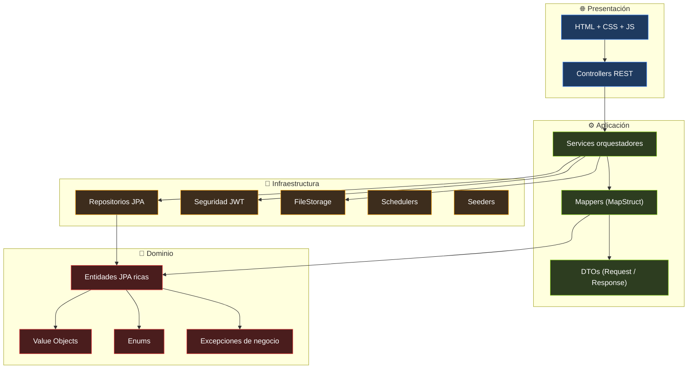

# 🧱 Arquitectura del Sistema — MundoTerraza

> Documento técnico que describe la arquitectura, capas, dependencias y decisiones de diseño del backend y frontend de MundoTerraza.

---

## 📖 Tabla de contenidos

1. [Visión general](#-visión-general)
2. [Estilo arquitectónico](#-estilo-arquitectónico)
3. [Diagrama de capas](#-diagrama-de-capas)
4. [Regla de dependencias](#-regla-de-dependencias)
5. [Estructura de paquetes](#-estructura-de-paquetes)
6. [Descripción por capa](#-descripción-por-capa)
7. [Flujo de una petición](#-flujo-de-una-petición)
8. [Patrones aplicados](#-patrones-aplicados)
9. [Frontend](#-frontend)
10. [Observabilidad](#-observabilidad)
11. [Decisiones arquitectónicas clave](#-decisiones-arquitectónicas-clave)

---

## 🎯 Visión general

MundoTerraza es una aplicación web monolítica con separación estricta de responsabilidades. El backend sigue una **arquitectura hexagonal pragmática** con **DDD aplicado**, donde el dominio es el núcleo y todas las dependencias apuntan hacia él. El frontend es una **MPA (Multi-Page Application)** construida con **JavaScript vanilla** y **ES Modules nativos**.

| Aspecto | Decisión |
|---------|----------|
| Estilo backend | Hexagonal pragmática + DDD aplicado |
| Estilo frontend | MPA con ES Modules nativos |
| Comunicación | REST/JSON sobre HTTPS |
| Persistencia | JPA/Hibernate + MySQL 8 + Flyway |
| Autenticación | JWT stateless (access + refresh) |
| Presentación | Spring MVC (adaptadores de entrada) |

---

## 🏛 Estilo arquitectónico

### Hexagonal pragmática

La arquitectura hexagonal pura exige separar el modelo de dominio del modelo de persistencia. En MundoTerraza se aplica una variante **pragmática**: las entidades JPA actúan simultáneamente como entidades de dominio, evitando el coste de mantener dos modelos paralelos y sus mappers.

**Ventajas del enfoque pragmático:**

- Menos código, menos mappers, menos superficie de bugs.
- Proyecto legible y mantenible por un equipo pequeño.
- Permite migrar a hexagonal estricto si el proyecto lo requiere.

**Compromisos aceptados:**

- El dominio arrastra anotaciones JPA (`@Entity`, `@Column`, etc.).
- El dominio conoce Hibernate a través de `@PrePersist`, `@PreUpdate` y lazy loading.
- Aceptable mientras no se cambie de motor de persistencia.

### DDD aplicado

Se toman de DDD los conceptos con mayor retorno:

- **Entidades ricas** con invariantes y comportamiento (no anémicas).
- **Value Objects** inmutables con validación en constructor (`Dinero`, `Email`, `Dni`, `Telefono`, `Password`, `Capacidad`, `Porcentaje`, `Coordenada`).
- **Agregados** identificables por raíz (`Reserva`, `Propiedad`, `Usuario`).
- **Excepciones de dominio** explícitas (`BusinessException`, `NotFoundException`, `ForbiddenException`).

No se aplican:

- Eventos de dominio.
- Anti-corruption layers.
- Repositorios de dominio separados de los repositorios Spring Data.

---

## 📊 Diagrama de capas



---

## 📐 Regla de dependencias

La regla fundamental es: **las dependencias apuntan siempre hacia el dominio**.

```
┌─────────────────────┐
│     Controller      │  ← Adaptador de entrada HTTP
└──────────┬──────────┘
           ↓
┌─────────────────────┐
│     Service         │  ← Orquestación de casos de uso
└──────────┬──────────┘
           ↓
┌─────────────────────┐
│     Repository      │  ← Adaptador de salida (JPA)
└──────────┬──────────┘
           ↓
┌─────────────────────┐
│      Domain         │  ← Núcleo: sin dependencias externas
└─────────────────────┘
```

| Capa | Puede depender de | No puede depender de |
|------|-------------------|----------------------|
| **Controller** | Service, DTO | Repository, Domain (entidades), Infrastructure |
| **Service** | Domain, Repository, DTO, Mapper, Security, Storage | Controller |
| **Repository** | Domain (entidades) | Service, Controller |
| **Domain** | Java estándar, Jakarta Persistence | Spring, HTTP, Repository, Service |
| **Config** | Todo (es transversal) | — |

---

## 🗂 Estructura de paquetes

```
app/
│
├── MundoTerrazaApplication.java       Punto de entrada Spring Boot
│
├── config/                            Configuración transversal
│   ├── SecurityConfig.java            SecurityFilterChain, BCrypt, CORS
│   ├── WebConfig.java                 Recursos estáticos /uploads/**
│   ├── OpenApiConfig.java             Swagger UI + Bearer auth
│   ├── JacksonConfig.java             JavaTimeModule, ISO-8601
│   └── GlobalExceptionHandler.java    Manejo unificado de errores
│
├── controller/                        Adaptadores de entrada HTTP (11)
│   ├── AuthController.java
│   ├── UsuarioController.java
│   ├── PropiedadController.java
│   ├── HabitacionController.java
│   ├── CatalogoController.java
│   ├── ReservaController.java
│   ├── PagoController.java
│   ├── ReviewController.java
│   ├── FavoritoController.java
│   ├── NotificacionController.java
│   └── LiquidacionController.java
│
├── application/                       Capa de orquestación
│   ├── dto/
│   │   ├── request/                   17 DTOs con Bean Validation
│   │   └── response/                  19 DTOs (records inmutables)
│   ├── mapper/                        13 mappers MapStruct
│   └── service/                       13 servicios @Service
│
├── domain/                            Núcleo del sistema
│   ├── model/                         15 entidades JPA + ServicioPropiedadId
│   ├── valueobject/                   8 Value Objects inmutables
│   ├── enums/                         13 enums del dominio
│   ├── converter/                     6 AttributeConverters JPA
│   └── exception/                     7 excepciones de negocio
│
└── infrastructure/                    Adaptadores de salida
    ├── repository/                    15 repositorios Spring Data JPA
    ├── security/                      6 componentes JWT
    ├── storage/                       FileStorageService
    ├── observability/                 2 componentes (MDC + Aspect)
    ├── scheduler/                     2 jobs programados
    └── seed/                          2 seeders de catálogos
```

---

## 📚 Descripción por capa

### 🎯 Domain — Núcleo

Contiene la lógica de negocio pura. No conoce Spring, HTTP, ni infraestructura.

**`domain/model/`** — Entidades JPA con comportamiento:

- `Usuario`: transición `HUESPED → ANFITRION`, registro de intentos fallidos, bloqueo.
- `Propiedad`: ciclo `BORRADOR → ACTIVA → INACTIVA → ELIMINADA`, gestión de imágenes y habitaciones.
- `Reserva`: cálculo de comisión (15%), transiciones de estado (PENDIENTE → CONFIRMADA → COMPLETADA).
- `Review`: plazo de edición de 30 días, respuesta única del anfitrión.
- `Pago`, `Liquidacion`, `HistorialEstadoReserva`, `Notificacion`, `BloqueoFecha`.

**`domain/valueobject/`** — Tipos inmutables con validación en constructor:

| VO | Invariante |
|----|------------|
| `Dinero` | `BigDecimal` escala 2, HALF_UP, no negativo |
| `Email` | Regex, minúsculas, ≤150 caracteres |
| `Dni` | Exactamente 8 dígitos |
| `Telefono` | Exactamente 9 dígitos, inicia con 9 |
| `Password` | 6..72 caracteres, BCrypt en servicio |
| `Capacidad` | Entero 1..50 |
| `Porcentaje` | 0..100, escala 2 |
| `Coordenada` | Latitud -90..90, longitud -180..180 |

**`domain/exception/`** — Jerarquía de excepciones:

```
RuntimeException
 └─ BusinessException
     ├─ NotFoundException
     ├─ UnauthorizedException
     ├─ ForbiddenException
     ├─ InvalidCredentialsException
     ├─ AccountLockedException
     └─ ConflictoException
```

### ⚙️ Application — Orquestación

Coordina los casos de uso. Usa el dominio y los adaptadores, pero **no contiene reglas de negocio puras**.

**`application/dto/request/`** — DTOs de entrada con Bean Validation:

- `@NotBlank`, `@Email`, `@Size`, `@Pattern`, `@Positive`, `@DecimalMin`, `@Min`, `@Max`.
- Los controllers reciben estos DTOs con `@Valid`.

**`application/dto/response/`** — Records inmutables de salida:

- Ejemplo: `AuthResponse`, `PropiedadDetalleResponse`, `ReservaResponse`, `PageResponse<T>`.

**`application/mapper/`** — Mappers MapStruct generados en build:

- `componentModel = "spring"`.
- Mapeos explícitos para enums (`Enum.name()`), VOs (`VO.getValor()`) y relaciones anidadas.

**`application/service/`** — Servicios orquestadores:

| Servicio | Responsabilidad |
|----------|----------------|
| `AuthService` | Registro, login, refresh, become-host |
| `UsuarioService` | Perfil y actualización |
| `PropiedadService` | CRUD, publicación, imágenes |
| `HabitacionService` | CRUD, gestión de imágenes |
| `DisponibilidadService` | Cálculo de disponibilidad por rango |
| `ReservaService` | Crear, confirmar, cancelar, historial |
| `PagoService` | Registrar, aprobar, rechazar |
| `LiquidacionService` | Generación de liquidaciones |
| `ReviewService` | Crear, editar, responder, recalcular rating |
| `FavoritoService` | Wishlist |
| `NotificacionService` | Emisión y gestión de notificaciones |
| `BloqueoFechaService` | Bloqueos del anfitrión |
| `CatalogoService` | Lectura de categorías y servicios |

### 🔌 Infrastructure — Adaptadores

**`infrastructure/repository/`** — 15 interfaces Spring Data JPA:

- Métodos derivados (`findByCorreoIgnoreCase`).
- `@Query` JPQL con `@EntityGraph` para evitar N+1.
- `PropiedadSpecification` para filtros dinámicos con Criteria API.

**`infrastructure/security/`** — 6 componentes:

| Componente | Rol |
|-----------|-----|
| `JwtService` | Generar, validar y parsear tokens |
| `JwtAuthenticationFilter` | OncePerRequestFilter que autentica el access token |
| `CustomUserDetails` | Envuelve `Usuario` como `UserDetails` |
| `CustomUserDetailsService` | Carga por ID y por correo |
| `RestAuthenticationEntryPoint` | 401 en JSON |
| `RestAccessDeniedHandler` | 403 en JSON |

**`infrastructure/storage/FileStorageService`**:

- Guarda imágenes en `uploads/` con UUID.
- Valida MIME, extensión, tamaño (5 MB) y contenido real (`ImageIO.read`).
- Previene path traversal con `startsWith(root)`.

**`infrastructure/observability/`**:

- `RequestIdFilter`: asigna UUID a cada request en MDC.
- `LoggingAspect`: `@Around` sobre `app.application.service..*` (DEBUG).

**`infrastructure/scheduler/`**:

- `PurgaNotificacionesJob`: borra notificaciones leídas > 90 días (diario 03:00).
- `ReconciliacionRatingJob`: recalcula rating de propiedades (diario 03:30).

**`infrastructure/seed/`**:

- `CategoriaSeeder`: 7 categorías base.
- `ServicioSeeder`: 15 servicios base.

---

## 🔄 Flujo de una petición

Ejemplo: `POST /api/reservas`

```
1. Navegador envía POST con Authorization: Bearer <access>
   ↓
2. RequestIdFilter (infrastructure/observability)
   → Asigna un UUID al MDC
   ↓
3. JwtAuthenticationFilter (infrastructure/security)
   → Valida firma y expiración
   → Carga Usuario y lo coloca en SecurityContext
   ↓
4. ReservaController (controller)
   → Valida @Valid sobre CrearReservaRequest
   → Obtiene usuario autenticado de @AuthenticationPrincipal
   → Llama a reservaService.crear(usuarioId, request)
   ↓
5. LoggingAspect intercepta la llamada (DEBUG)
   ↓
6. ReservaService (application/service)
   → Carga Usuario y Habitacion (repository)
   → Verifica que no es el propio anfitrión (dominio)
   → Delega a DisponibilidadService.verificarDisponibilidad
   ↓
7. DisponibilidadService consulta ReservaRepository y BloqueoFechaRepository
   → Calcula unidades disponibles en el rango
   ↓
8. ReservaService construye Reserva (dominio)
   → Cálculo de subtotal, comisión (15%), montoAnfitrion
   → Persiste con ReservaRepository
   → Registra historial con HistorialEstadoReservaRepository
   → Emite notificaciones (huésped + anfitrión)
   ↓
9. ReservaMapper traduce Entidad → ReservaResponse (record)
   ↓
10. Controller devuelve ResponseEntity<ReservaResponse> con 201
    ↓
11. GlobalExceptionHandler captura excepciones si las hubiera
    → Devuelve ErrorResponse uniforme
    ↓
12. RequestIdFilter limpia el MDC
```

---

## 🎨 Patrones aplicados

| Patrón | Ubicación | Propósito |
|--------|-----------|-----------|
| **DTO** | `application/dto/` | Aislar la representación HTTP de las entidades |
| **Mapper** | `application/mapper/` | Traducción bidireccional entidad ↔ DTO (MapStruct) |
| **Repository** | `infrastructure/repository/` | Abstracción sobre el acceso a datos |
| **Specification** | `PropiedadSpecification` | Filtros dinámicos con Criteria API |
| **Strategy** | Variantes de `FileStorageService` | Almacenamiento local hoy, S3 mañana |
| **Builder** | Constructores estáticos de VOs (`Email.de(...)`) | Alternativa a constructores múltiples |
| **Value Object** | `domain/valueobject/` | Tipos inmutables con invariantes |
| **Aggregate Root** | `Reserva`, `Propiedad`, `Usuario` | Control transaccional de sub-entidades |
| **Filter Chain** | `JwtAuthenticationFilter` | Intercepción por request |
| **Aspect** | `LoggingAspect` | Cross-cutting concern (logging) |
| **Observer** | `NotificacionService` | Reacción a eventos de dominio |

---

## 🎨 Frontend

### Estructura

```
static/
├── index.html                    Catálogo
├── auth.html                     Login / Registro
├── detalle.html                  Detalle + reserva
│
├── css/                          Sistema de diseño BEM + tokens
│   ├── style.css                 Entry point (solo @imports)
│   ├── base/                     tokens, reset, typography
│   ├── components/               10 componentes CSS
│   ├── utilities/                helpers
│   └── pages/                    3 páginas específicas
│
└── js/                           ES Modules nativos
    ├── api.js                    Cliente HTTP con JWT + refresh
    ├── session.js                Tokens y usuario
    ├── format.js                 Formateo (precios, fechas)
    ├── services/                 Wrappers por recurso
    ├── components/               Componentes UI reutilizables
    ├── features/                 Features complejas (become-host, publish)
    └── pages/                    Entry points por página
```

### Capas del frontend

```
      pages/         ← Entry points (index, auth, detalle)
        ↓
    features/        ← Features complejas (becomeHost, publishProperty)
        ↓
   components/       ← Componentes UI (navbar, card, modal, toast)
        ↓
    services/        ← Wrappers de endpoints (/api/propiedades, /api/auth)
        ↓
      api.js         ← Cliente HTTP centralizado (JWT + refresh + errores)
        ↓
    session.js       ← Gestión de tokens (access en sessionStorage, refresh en localStorage)
```

### Reglas del frontend

- **Ningún** `fetch` directo fuera de `api.js`.
- **Ningún** archivo HTML con `<script>` inline.
- **Un solo** `<link rel="stylesheet" href="css/style.css">` por HTML.
- **Un solo** `<script type="module" src="js/pages/*.js">` por HTML.
- Nomenclatura **BEM** en CSS, **camelCase** en JS.

---

## 📡 Observabilidad

### Correlación por `requestId`

Cada petición HTTP obtiene un `requestId` (UUID acortado) que se propaga por MDC durante todo el ciclo:

```
2026-10-10 11:16:10.605 [http-nio-8080-exec-1] INFO  [a1b2c3d4] app.application.service.ReservaService - Reserva creada id=42
```

### Niveles de log

| Nivel | Uso |
|-------|-----|
| `ERROR` | Fallos no controlados, excepciones inesperadas |
| `WARN` | Intentos de login fallidos, accesos denegados, solapes de reserva |
| `INFO` | Hitos de negocio (usuario registrado, reserva creada, propiedad publicada) |
| `DEBUG` | Entrada/salida de servicios (via `LoggingAspect`) |
| `TRACE` | Detalle fino (no usado por defecto) |

### Configuración

- `logback-spring.xml` con rotación diaria y retención 30 días.
- Consola con colores en perfil `dev`, archivo `logs/mundo-terraza.log` en `prod`.
- Sin passwords ni tokens en logs.

---

## 🔑 Decisiones arquitectónicas clave

| # | Decisión | Justificación |
|---|----------|---------------|
| 1 | Hexagonal pragmática en lugar de estricta | Reduce duplicación de entidades y mappers; suficiente para el alcance |
| 2 | DDD aplicado sin eventos de dominio | Los eventos no aportan complejidad justificada en esta etapa |
| 3 | JWT stateless en lugar de sesiones | Portabilidad para SPA y móvil; sin estado compartido |
| 4 | Refresh token en `localStorage` | Persiste entre sesiones; el access vive en `sessionStorage` |
| 5 | Flyway en lugar de `ddl-auto=update` | Esquema versionado y auditable; listo para producción |
| 6 | MapStruct en lugar de mappers manuales | Cero reflexión en runtime; errores detectados en build |
| 7 | BEM + tokens en CSS | Sin frameworks externos; design system propio y consistente |
| 8 | ES Modules nativos sin bundler | Menos herramientas, migración futura a Vite es trivial |
| 9 | Soft delete en entidades con historial | Conserva integridad referencial y permite auditoría |
| 10 | Comisión del 15% calculada en el dominio | Regla de negocio, no configurable por usuario; vive en la entidad |
| 11 | Reserva sobre Habitación, no sobre Propiedad | Fiel a Airbnb: una propiedad puede tener varias unidades reservables |
| 12 | Rating denormalizado en Propiedad | Evita `AVG` costoso en cada consulta de catálogo |
| 13 | Bloqueo de cuenta tras 5 intentos fallidos | Mitigación básica contra fuerza bruta |
| 14 | Sin verificación de email en v1 | Fuera de alcance; el backend está preparado para añadirlo |
