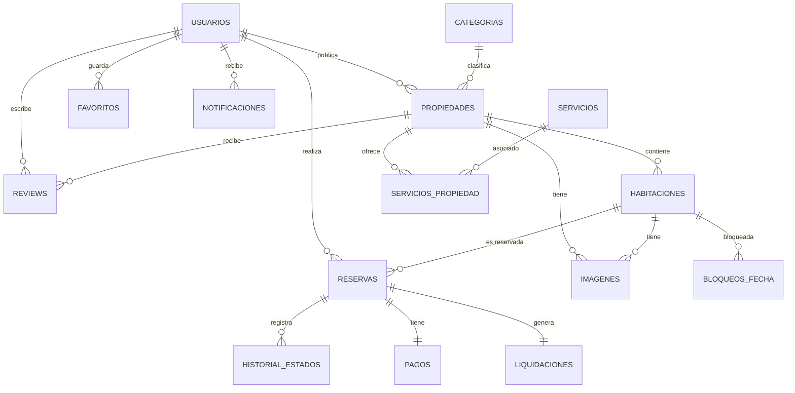

# 🎯 Modelo de Dominio — MundoTerraza

> Documento técnico que describe las entidades, Value Objects, relaciones, invariantes y reglas de negocio del dominio de MundoTerraza.

---

## 📖 Tabla de contenidos

1. [Visión general](#-visión-general)
2. [Lenguaje ubicuo](#-lenguaje-ubicuo)
3. [Roles y habilitaciones](#-roles-y-habilitaciones)
4. [Diagrama de relaciones](#-diagrama-de-relaciones)
5. [Agregados](#-agregados)
6. [Entidades](#-entidades)
7. [Value Objects](#-value-objects)
8. [Enums](#-enums)
9. [Reglas de negocio transversales](#-reglas-de-negocio-transversales)
10. [Ciclos de vida](#-ciclos-de-vida)
11. [Excepciones de dominio](#-excepciones-de-dominio)

---

## 🎯 Visión general

El dominio de MundoTerraza modela una plataforma de reservas de alojamientos donde:

- **Usuarios** se registran como **huéspedes** y pueden habilitarse como **anfitriones**.
- **Anfitriones** publican **propiedades** con múltiples **habitaciones** reservables de forma independiente.
- **Huéspedes** reservan habitaciones y pagan en un solo paso (instant booking). La pasarela simulada confirma la reserva automáticamente. Al finalizar la estadía, el anfitrión completa la reserva, se genera la liquidación y el huésped puede dejar una **reseña**.
- La plataforma retiene una **comisión del 15%** de cada reserva completada.

El diseño sigue principios de **DDD aplicado**: entidades ricas con invariantes, Value Objects inmutables y agregados con raíz identificable.

---

## 🗣 Lenguaje ubicuo

| Término | Significado |
|---------|-------------|
| **Usuario** | Cualquier persona registrada. Puede ser huésped o anfitrión (habilitación). |
| **Huésped** | Usuario que busca, reserva y reseña alojamientos. |
| **Anfitrión** | Usuario habilitado que publica y gestiona propiedades. |
| **Propiedad** | Alojamiento publicado por un anfitrión (casa, hotel, departamento, etc.). |
| **Habitación** | Unidad reservable dentro de una propiedad (tiene precio y capacidad propios). |
| **Reserva** | Intención confirmada de un huésped de ocupar una habitación en un rango de fechas. |
| **Pago** | Registro económico asociado a una reserva. |
| **Liquidación** | Cálculo de la comisión de la plataforma y el monto neto del anfitrión. |
| **Review** | Reseña con rating (1..5) que un huésped deja sobre una propiedad. |
| **Favorito** | Marcador personal de un usuario sobre una propiedad. |
| **Notificación** | Mensaje in-app generado por eventos del sistema. |
| **Bloqueo** | Rango de fechas que el anfitrión marca como no disponible. |
| **Comisión** | Porcentaje (15%) que la plataforma retiene del subtotal de la reserva. |
| **Instant booking** | Modelo de reserva donde el huésped paga al reservar y la confirmación es automática. La pasarela simulada aprueba o rechaza el pago. |

---

## 👥 Roles y habilitaciones

MundoTerraza no tiene un sistema de roles tradicional con múltiples tipos de usuario. Tiene **una sola entidad `Usuario`** con dos estados:

- **HUESPED**: estado inicial tras el registro. Puede buscar, reservar y reseñar.
- **ANFITRION**: habilitación permanente que se activa al completar el formulario "Hazte Anfitrión".

### Reglas

- Todos los usuarios se registran como **HUESPED**.
- La transición `HUESPED → ANFITRION` es **irreversible** en esta versión.
- Un **ANFITRION** también puede reservar como huésped en propiedades ajenas.
- Un **ANFITRION** no puede reservar sus propias propiedades.
- El campo `modoActivo` es una preferencia de UI, no un permiso real.

---

## 🔗 Diagrama de relaciones



### Resumen de cardinalidades

| Relación | Cardinalidad | Tipo | Semántica |
|----------|--------------|------|-----------|
| Usuario → Propiedad | 1:N | Asociación | Un anfitrión publica muchas propiedades |
| Usuario → Reserva | 1:N | Asociación | Un huésped realiza muchas reservas |
| Usuario → Review | 1:N | Asociación | Un huésped escribe muchas reseñas |
| Usuario → Favorito | 1:N | Asociación | Un usuario guarda muchas propiedades |
| Propiedad → Categoría | N:1 | Composición lógica | Una propiedad pertenece a una categoría |
| Propiedad → Habitación | 1:N | Composición | Una propiedad contiene muchas habitaciones |
| Propiedad → Imagen | 1:N | Agregación | Una propiedad tiene muchas imágenes |
| Propiedad → Review | 1:N | Agregación | Una propiedad recibe muchas reseñas |
| Propiedad ↔ Servicio | N:M | Asociación | Vía entidad puente `ServicioPropiedad` |
| Habitación → Reserva | 1:N | Asociación | Una habitación recibe muchas reservas |
| Habitación → Bloqueo | 1:N | Composición | Una habitación puede tener bloqueos |
| Reserva → Historial | 1:N | Composición | Cada reserva registra sus cambios de estado |
| Reserva → Pago | 1:1 | Composición | Cada reserva tiene un único pago |
| Reserva → Liquidación | 1:1 | Composición | Cada reserva completada genera una liquidación |

---

## 🧩 Agregados

Un **agregado** es un conjunto de entidades tratadas como unidad transaccional. Cada agregado tiene una raíz y solo a través de ella se modifica.

### Agregado `Usuario`

```
Usuario (raíz)
├── Rol / habilitación
└── (sin sub-entidades)
```

**Invariantes:**

- Correo único, insensible a mayúsculas.
- Contraseña hasheada con BCrypt, nunca en texto plano.
- `esAnfitrion` solo puede pasar de `false` a `true` (irreversible).

### Agregado `Propiedad`

```
Propiedad (raíz)
├── Imagen[] (imágenes generales)
├── Habitación[]
│   ├── Imagen[] (imágenes de la habitación)
│   └── BloqueoFecha[]
└── ServicioPropiedad[] (asociación con servicios)
```

**Invariantes:**

- Una propiedad no puede publicarse sin al menos 1 imagen y 1 habitación.
- Máximo 5 imágenes por propiedad y por habitación.
- El orden de las imágenes es único dentro de cada propietario (propiedad o habitación).
- No se puede eliminar una categoría con propiedades asociadas.

### Agregado `Reserva`

```
Reserva (raíz)
├── HistorialEstadoReserva[]
└── Pago (1:1)
```

**Invariantes:**

- La propiedad de la habitación debe estar en estado `ACTIVA`.
- Fecha fin estrictamente posterior a la fecha inicio.
- No puede solaparse con reservas activas de la misma habitación (respetando stock).
- Precio congelado al crear la reserva.
- No se puede cancelar una reserva `COMPLETADA`.
- Solo se puede confirmar una reserva `PENDIENTE`.
- Solo se puede completar una reserva `CONFIRMADA`.
- Solo el anfitrión de la propiedad puede completar la reserva.

### Agregado `Review`

```
Review (raíz)
└── (sin sub-entidades)
```

**Invariantes:**

- Rating entre 1 y 5.
- Comentario entre 10 y 500 caracteres.
- Una sola review por (usuario, propiedad).
- Solo puede reseñar quien tiene una reserva COMPLETADA previa.
- Editable y eliminable solo dentro de los 30 días posteriores a la creación.

---

## 🏗 Entidades

### Usuario

Representa a cualquier persona registrada en la plataforma.

| Campo | Tipo | Descripción |
|-------|------|-------------|
| `id` | `Long` | Identificador único |
| `nombre` | `String` | Nombre completo (2..100 caracteres) |
| `correo` | `Email` | Correo único, normalizado a minúsculas |
| `passwordHash` | `String` | Hash BCrypt de la contraseña |
| `telefono` | `Telefono` | Teléfono (solo si es anfitrión) |
| `dni` | `Dni` | DNI (solo si es anfitrión) |
| `ciudad` | `String` | Ciudad de residencia |
| `biografia` | `String` | Descripción personal |
| `esAnfitrion` | `boolean` | Habilitación como anfitrión |
| `fechaAnfitrion` | `LocalDateTime` | Fecha de habilitación |
| `estado` | `EstadoUsuario` | ACTIVA / ELIMINADA |
| `intentosFallidos` | `int` | Contador de intentos fallidos de login |
| `bloqueadoHasta` | `LocalDateTime` | Fecha hasta la que está bloqueado |
| `fechaCreacion` | `LocalDateTime` | Auditoría |
| `fechaActualizacion` | `LocalDateTime` | Auditoría |

**Métodos de negocio:**

- `convertirEnAnfitrion(telefono, dni, ciudad, biografia)`.
- `registrarIntentoFallido(maxIntentos, minutosBloqueo)`.
- `reiniciarIntentos()`.
- `estaBloqueado()`.

### Propiedad

Alojamiento publicado por un anfitrión.

| Campo | Tipo | Descripción |
|-------|------|-------------|
| `id` | `Long` | Identificador único |
| `anfitrion` | `Usuario` | Dueño de la propiedad |
| `categoria` | `Categoria` | Clasificación |
| `titulo` | `String` | Título (5..150 caracteres) |
| `descripcion` | `String` | Descripción (20..1000 caracteres) |
| `ubicacion` | `String` | Dirección textual |
| `latitud` | `double` | Coordenada (-90..90) |
| `longitud` | `double` | Coordenada (-180..180) |
| `tipoAlojamiento` | `TipoAlojamiento` | Enum |
| `politicaCancelacion` | `PoliticaCancelacion` | Enum |
| `estado` | `EstadoPropiedad` | BORRADOR / ACTIVA / INACTIVA / ELIMINADA |
| `ratingPromedio` | `double` | Denormalizado |
| `totalReviews` | `int` | Denormalizado |
| `esFavoritoEntreHuespedes` | `boolean` | Denormalizado |
| `habitaciones` | `List<Habitacion>` | Sub-entidades |
| `imagenes` | `List<Imagen>` | Sub-entidades |
| `servicios` | `List<ServicioPropiedad>` | Entidad puente |

**Métodos de negocio:**

- `publicar()`: BORRADOR → ACTIVA (requiere ≥1 habitación y ≥1 imagen).
- `desactivar()`: ACTIVA → INACTIVA.
- `marcarEliminada()`: → ELIMINADA.
- `actualizarRating(promedio, total)`: recalcula rating y flag de favorito.
- `agregarHabitacion(habitacion)`, `agregarImagen(imagen)`.

### Habitacion

Unidad reservable dentro de una propiedad.

| Campo | Tipo | Descripción |
|-------|------|-------------|
| `id` | `Long` | Identificador único |
| `propiedad` | `Propiedad` | Propiedad contenedora |
| `nombre` | `String` | Nombre de la habitación |
| `descripcion` | `String` | Descripción |
| `precioNoche` | `Dinero` | Precio por noche |
| `maxAdultos` | `int` | ≥1 |
| `maxNinos` | `int` | ≥0 |
| `maxBebes` | `int` | ≥0 |
| `maxMascotas` | `int` | ≥0 |
| `cantidadDormitorios` | `int` | ≥1 |
| `cantidadBanios` | `int` | ≥1 |
| `metrosCuadrados` | `double` | >0 |
| `stockTotal` | `int` | ≥1 |
| `estado` | `EstadoHabitacion` | DISPONIBLE / MANTENIMIENTO / INACTIVA |
| `imagenes` | `List<Imagen>` | Sub-entidades |

**Métodos de negocio:**

- `ponerEnMantenimiento()`, `marcarDisponible()`.
- `desactivar()`.
- `actualizarPrecio(nuevoPrecio)`.

### Reserva

Reserva de una habitación por un huésped en un rango de fechas.

| Campo | Tipo | Descripción |
|-------|------|-------------|
| `id` | `Long` | Identificador único |
| `usuario` | `Usuario` | Huésped |
| `habitacion` | `Habitacion` | Unidad reservada |
| `propiedad` | `Propiedad` | Denormalizado |
| `cantidad` | `int` | Unidades reservadas |
| `fechaInicio`, `fechaFin` | `LocalDate` | Rango |
| `precioPorNocheAlCrear` | `Dinero` | Precio congelado |
| `subtotal` | `Dinero` | precioNoche × noches × cantidad |
| `comisionPlataforma` | `Dinero` | 15% del subtotal |
| `montoAnfitrion` | `Dinero` | subtotal - comisión |
| `estado` | `EstadoReserva` | PENDIENTE / CONFIRMADA / CANCELADA / COMPLETADA |
| `historial` | `List<HistorialEstadoReserva>` | Auditoría de estados |
| `pago` | `Pago` | 1:1 |

**Métodos de negocio:**

- `confirmar()`, `cancelar()`, `completar()`.
- `getNoches()`: cálculo entre fechas.

### Pago

| Campo | Tipo | Descripción |
|-------|------|-------------|
| `id` | `Long` | Identificador |
| `reserva` | `Reserva` | 1:1 |
| `monto` | `Dinero` | Coincide con el subtotal de la reserva |
| `tipoPago` | `TipoPago` | EFECTIVO / TARJETA / YAPE / PLIN / TRANSFERENCIA |
| `estado` | `EstadoPago` | PENDIENTE / APROBADO / RECHAZADO / REEMBOLSADO |
| `referencia` | `String` | Código externo (opcional) |
| `fecha` | `LocalDateTime` | Fecha del registro |

**Métodos de negocio:**

- `aprobar()`, `rechazar()` — invocados automáticamente por `PagoService.registrar()` según el resultado de la pasarela simulada.
- `reembolsar()` — existe en el dominio, no expuesto en la API v1.

### Liquidacion

| Campo | Tipo | Descripción |
|-------|------|-------------|
| `id` | `Long` | Identificador |
| `reserva` | `Reserva` | 1:1 |
| `anfitrion` | `Usuario` | Beneficiario |
| `subtotal` | `Dinero` | Copia del subtotal de la reserva |
| `porcentajeComision` | `Porcentaje` | 15.00 |
| `montoComision` | `Dinero` | Retenido por la plataforma |
| `montoNeto` | `Dinero` | A transferir al anfitrión |
| `estado` | `EstadoLiquidacion` | PENDIENTE / PAGADA |
| `fechaGeneracion` | `LocalDateTime` | Auditoría |

**Métodos de negocio:**

- `marcarPagada()`.

### Review

| Campo | Tipo | Descripción |
|-------|------|-------------|
| `id` | `Long` | Identificador |
| `usuario` | `Usuario` | Autor |
| `propiedad` | `Propiedad` | Reseñada |
| `rating` | `int` | 1..5 |
| `comentario` | `String` | 10..500 caracteres |
| `habitacionMencionada` | `String` | Texto libre opcional |
| `respuestaAnfitrion` | `String` | Respuesta del anfitrión |
| `fechaRespuesta` | `LocalDateTime` | Fecha de respuesta |
| `estado` | `EstadoReview` | ACTIVA / ELIMINADA |
| `fechaCreacion` | `LocalDateTime` | Auditoría |
| `fechaEdicion` | `LocalDateTime` | Última edición |
| `fechaEliminacion` | `LocalDateTime` | Soft delete |

**Métodos de negocio:**

- `editar(rating, comentario)`: dentro de 30 días.
- `responder(respuesta)`: una sola vez.
- `eliminar()`: dentro de 30 días.
- `dentroDePlazoEdicion()`.

### HistorialEstadoReserva

| Campo | Tipo | Descripción |
|-------|------|-------------|
| `id` | `Long` | Identificador |
| `reserva` | `Reserva` | Contenedora |
| `estadoAnterior` | `EstadoReserva` | Estado previo |
| `estadoNuevo` | `EstadoReserva` | Estado nuevo |
| `motivo` | `String` | Texto descriptivo |
| `fecha` | `LocalDateTime` | Momento del cambio |

> Entidad **inmutable**. No expone setters de negocio.

### Favorito

| Campo | Tipo | Descripción |
|-------|------|-------------|
| `id` | `Long` | Identificador |
| `usuario` | `Usuario` | Dueño |
| `propiedad` | `Propiedad` | Marcada como favorita |
| `fecha` | `LocalDateTime` | Momento del marcado |

### Notificacion

| Campo | Tipo | Descripción |
|-------|------|-------------|
| `id` | `Long` | Identificador |
| `usuario` | `Usuario` | Destinatario |
| `tipo` | `TipoNotificacion` | Enum |
| `titulo` | `String` | Título |
| `mensaje` | `String` | Cuerpo |
| `referenciaId` | `Long` | ID del recurso relacionado |
| `leida` | `boolean` | Estado de lectura |
| `fechaCreacion` | `LocalDateTime` | Auditoría |

**Métodos de negocio:**

- `marcarLeida()`.

### BloqueoFecha

| Campo | Tipo | Descripción |
|-------|------|-------------|
| `id` | `Long` | Identificador |
| `habitacion` | `Habitacion` | Bloqueada |
| `fechaInicio`, `fechaFin` | `LocalDate` | Rango bloqueado |
| `motivo` | `String` | Texto libre |

### Categoria

| Campo | Tipo | Descripción |
|-------|------|-------------|
| `id` | `Long` | Identificador |
| `nombre` | `String` | Único |
| `descripcion` | `String` | Opcional |
| `activa` | `boolean` | Estado |

**Métodos de negocio:**

- `activar()`, `desactivar()`.

### Servicio

| Campo | Tipo | Descripción |
|-------|------|-------------|
| `id` | `Long` | Identificador |
| `nombre` | `String` | Único |
| `icono` | `String` | Slug para icono |
| `activo` | `boolean` | Estado |

**Métodos de negocio:**

- `activar()`, `desactivar()`.

### ServicioPropiedad

Entidad puente con PK compuesta `(id_propiedad, id_servicio)`.

| Campo | Tipo | Descripción |
|-------|------|-------------|
| `id` | `ServicioPropiedadId` | PK compuesta |
| `propiedad` | `Propiedad` | N:1 |
| `servicio` | `Servicio` | N:1 |
| `fechaAsociacion` | `LocalDateTime` | Auditoría |

### Imagen

| Campo | Tipo | Descripción |
|-------|------|-------------|
| `id` | `Long` | Identificador |
| `url` | `String` | Ruta relativa `/uploads/...` |
| `orden` | `int` | 0 = portada |
| `propiedad` | `Propiedad` | Owner (exclusivo) |
| `habitacion` | `Habitacion` | Owner (exclusivo) |
| `fechaSubida` | `LocalDateTime` | Auditoría |

> Una imagen pertenece a **Propiedad** o a **Habitación**, nunca a ambas.

**Métodos de negocio:**

- `cambiarOrden(nuevoOrden)`.

---

## 💎 Value Objects

Los Value Objects son inmutables, se validan en el constructor y se comparan por valor.

### Dinero

- `BigDecimal` con escala 2 y redondeo HALF_UP.
- No admite valores nulos ni negativos.
- Operaciones: `sumar`, `restar`, `multiplicar(int)`.

### Email

- Formato validado con regex.
- Se normaliza a minúsculas al construirse.
- Longitud máxima: 150 caracteres.

### Dni

- Exactamente 8 dígitos numéricos.

### Telefono

- Exactamente 9 dígitos.
- Debe iniciar con 9.

### Password

- Longitud entre 6 y 72 caracteres.
- Se construye en texto plano (registro) o desde un hash ya calculado.

### Capacidad

- Entero entre 1 y 50.

### Porcentaje

- `BigDecimal` entre 0 y 100, escala 2.
- Operación `aplicarA(Dinero)`: aplica el porcentaje a un monto.

### Coordenada

- Latitud entre -90 y 90.
- Longitud entre -180 y 180.

---

## 🎲 Enums

| Enum | Valores |
|------|---------|
| `EstadoUsuario` | `ACTIVA`, `ELIMINADA` |
| `EstadoPropiedad` | `BORRADOR`, `ACTIVA`, `INACTIVA`, `ELIMINADA` |
| `EstadoHabitacion` | `DISPONIBLE`, `MANTENIMIENTO`, `INACTIVA` |
| `EstadoReserva` | `PENDIENTE`, `CONFIRMADA`, `CANCELADA`, `COMPLETADA` |
| `EstadoReview` | `ACTIVA`, `ELIMINADA` |
| `EstadoPago` | `PENDIENTE`, `APROBADO`, `RECHAZADO`, `REEMBOLSADO` |
| `EstadoLiquidacion` | `PENDIENTE`, `PAGADA` |
| `TipoAlojamiento` | `HOTEL`, `CASA`, `DEPARTAMENTO`, `HABITACION`, `LOFT`, `VILLA`, `HOSTAL` |
| `PoliticaCancelacion` | `FLEXIBLE`, `MODERADA`, `ESTRICTA`, `NO_REEMBOLSABLE` |
| `TipoPago` | `EFECTIVO`, `TARJETA`, `YAPE`, `PLIN`, `TRANSFERENCIA` |
| `TipoNotificacion` | `RESERVA_CREADA`, `RESERVA_CONFIRMADA`, `RESERVA_CANCELADA`, `RESERVA_COMPLETADA`, `PAGO_APROBADO`, `PAGO_RECHAZADO`, `REVIEW_RECIBIDA`, `REVIEW_RESPONDIDA` |

---

## 📏 Reglas de negocio transversales

### Autenticación y seguridad

- Contraseñas hasheadas con BCrypt, nunca en texto plano.
- Bloqueo de cuenta tras 5 intentos fallidos durante 15 minutos.
- El `id` del usuario **nunca** se recibe desde el body o URL; se obtiene del token.
- Un usuario autenticado solo accede a sus propios recursos.

### Propiedades

- Publicación requiere: categoría activa, ≥1 habitación, ≥1 imagen y **≥1 habitación en estado `DISPONIBLE`**.
- Máximo 5 imágenes por propiedad y por habitación.
- El anfitrión es el único autorizado a modificar su propiedad.
- No se puede eliminar una propiedad con reservas activas (soft delete).
- El cambio de precio no afecta reservas existentes (precio congelado).

### Reservas

- La reserva se realiza sobre una **habitación**, no sobre la propiedad.
- La **propiedad** de la habitación debe estar en estado `ACTIVA`. No se puede reservar en propiedades `BORRADOR`, `INACTIVA` o `ELIMINADA`.
- No se puede reservar la propia propiedad.
- La disponibilidad se valida por rango de fechas, considerando reservas activas y bloqueos.
- El subtotal = precioNoche × noches × cantidad.
- La comisión es del 15% del subtotal.
- El monto del anfitrión = subtotal - comisión.
- No se puede cancelar una reserva `COMPLETADA`.
- La reserva se confirma automáticamente al aprobar el pago (instant booking).
- Solo el **anfitrión de la propiedad** puede completar una reserva (transición `CONFIRMADA → COMPLETADA`).
- Cada cambio de estado genera una entrada en `HistorialEstadoReserva`.

### Pagos

- Un pago corresponde 1:1 a una reserva.
- El monto se copia del subtotal de la reserva al crear el pago.
- El endpoint público es `POST /api/pagos`. Simula la pasarela según la referencia:
  - Si empieza con `FAIL-` → pago `RECHAZADO`. La reserva sigue `PENDIENTE`.
  - Cualquier otra referencia (o `null`) → pago `APROBADO`. La reserva pasa a `CONFIRMADA` automáticamente.
- Reintento permitido: si existe un pago `RECHAZADO` previo, se reutiliza y se vuelve a simular.
- Si ya existe un pago `APROBADO`, se rechaza el request con `400`.

### Bloqueos de fecha

- Un `BloqueoFecha` no puede solaparse con otros `BloqueoFecha` ni con `Reserva` en estado `PENDIENTE` o `CONFIRMADA` de la misma habitación.
- Un `BloqueoFecha` anula la disponibilidad total del rango (el anfitrión bloquea la habitación completa, no una unidad del stock).

### Reviews

- Rating entre 1 y 5.
- Comentario entre 10 y 500 caracteres.
- Solo una review por (usuario, propiedad).
- Requiere reserva COMPLETADA previa.
- Editable y eliminable por el autor dentro de 30 días.
- Una sola respuesta del anfitrión.

### Borrado

- **Hard delete** si la entidad no tiene historial.
- **Soft delete** (estado `ELIMINADA`) si tiene reservas, reviews o historial.
- Al hacer **soft delete de una Propiedad**, sus **Habitaciones pasan a `INACTIVA`** automáticamente.
- Nunca se borran: `Reserva`, `Pago`, `Liquidacion`, `HistorialEstadoReserva`.

---

## 🔄 Ciclos de vida

### Usuario

```
[Registro] → HUESPED ──(become-host)──→ ANFITRION
                 │
                 └──(soft delete)──→ ELIMINADA
```

### Propiedad

```
[Crear] → BORRADOR ──(publicar)──→ ACTIVA ──(desactivar)──→ INACTIVA
              │                      │                          │
              └──────────────────────┴──────(eliminar)─────────┘
                                     ↓
                                 ELIMINADA
```

### Reserva

```
[Crear] → PENDIENTE ──(pago aprobado)──→ CONFIRMADA ──(completar)──→ COMPLETADA
              │                              │
              └──(cancelar)──→ CANCELADA ←───┘
```

**Disparadores:**
- `PENDIENTE`: se crea la reserva (`POST /api/reservas`).
- `CONFIRMADA`: el huésped registra y la pasarela simulada aprueba el pago (`POST /api/pagos` con referencia que no empieza con `FAIL-`). Es automático, no requiere acción manual.
- `CANCELADA`: `PUT /api/reservas/{id}/cancelar` por huésped o anfitrión. No se puede cancelar una reserva `COMPLETADA`.
- `COMPLETADA`: `PUT /api/reservas/{id}/completar` por el anfitrión. Genera la liquidación automáticamente.

### Pago

```
[POST /api/pagos] → PENDIENTE ──(pasarela simulada OK)──→ APROBADO ──(reembolsar)──→ REEMBOLSADO
                        │
                        └──(pasarela simulada FAIL-)──→ RECHAZADO
                                                          │
                                                          └──(reintento)──→ APROBADO
```

**Disparadores:**
- `PENDIENTE`: se crea el pago (`POST /api/pagos`).
- `APROBADO`: si la `referencia` **no** empieza con `FAIL-`. Confirmación automática de la reserva asociada.
- `RECHAZADO`: si la `referencia` empieza con `FAIL-`. La reserva sigue en `PENDIENTE`.
- `REEMBOLSADO`: existe el método `Pago.reembolsar()` en el dominio, pero **no está expuesto en la API v1**.

**Reintento:** si existe un pago en estado `RECHAZADO` para esa reserva, el huésped puede volver a llamar `POST /api/pagos` con una nueva referencia. El pago se reutiliza y se vuelve a simular. Si ya existe un pago `APROBADO`, el request devuelve `400`.

### Review

```
[Crear] → ACTIVA ──(eliminar por autor)──→ ELIMINADA
```

---

## ⚠️ Excepciones de dominio

Jerarquía de excepciones:

```
RuntimeException
 └─ BusinessException              → HTTP 400
     ├─ NotFoundException          → HTTP 404
     ├─ UnauthorizedException      → HTTP 401
     ├─ ForbiddenException         → HTTP 403
     ├─ InvalidCredentialsException → HTTP 401
     ├─ AccountLockedException     → HTTP 423
     └─ ConflictoException         → HTTP 409
```

| Excepción | Cuándo se lanza |
|-----------|-----------------|
| `BusinessException` | Regla de negocio violada genérica |
| `NotFoundException` | Recurso no encontrado |
| `UnauthorizedException` | Falta autenticación |
| `ForbiddenException` | Usuario autenticado sin permisos |
| `InvalidCredentialsException` | Login con credenciales incorrectas |
| `AccountLockedException` | Cuenta bloqueada por intentos fallidos |
| `ConflictoException` | Estado duplicado (ej: review ya existe) |

Todas son capturadas por `GlobalExceptionHandler` y traducidas a un `ErrorResponse` uniforme con `timestamp`, `status`, `error`, `mensaje`, `path` y (opcionalmente) `detalles`.
